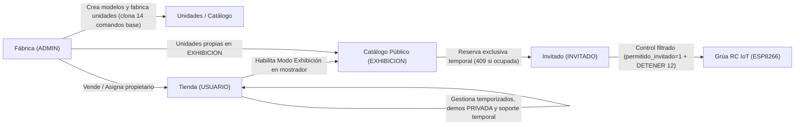

# Grúa RC IoT · Frontend Web Mobile First (4.1 Control · 4.2 Monitoreo · 4.3 Administración B2B2C)

Aplicación web **Mobile First** en **HTML5 semántico + CSS3 + Bootstrap 5.3 (SRI) + JavaScript ES6 modular puro** publicada en **GitHub Pages**, conectada al backend FastAPI/WSS en AWS EC2 (`https://grua-abraham.duckdns.org`).

Desarrollado por **Abraham Falcon Recinas**.

---

## Módulos Integrados

| Módulo | Descripción | Estado |
| --- | --- | :---: |
| **4.1 Control** | Joystick circular táctil + teclado WASD/flechas, D-Pad maquinaria (`3/4/5/6`), energía (`9/10/13/14`), prioridad absoluta de **`DETENER (12)`**, movimientos temporizados rápidos y rutinas DEMO con línea de tiempo en vivo | Completo |
| **4.2 Monitoreo** | Tarjeta de último movimiento en tiempo real, tabla de historial acotada a **máximo 10 individuales** (sin pasos internos de demo), catálogo de comandos de la unidad y panel de diagnóstico | Completo |
| **4.3 Administración B2B2C** | Login JWT real (`bcrypt` + refresh + logout optimista), menú dinámico por rol (**Fábrica `ADMIN`**, **Tienda `USUARIO`**, **Cliente Final `INVITADO`**), CRUD de modelos/capacidades/unidades/clientes/comandos/demos/auditoría, **Mis Vehículos** con editor visual táctil de demos privadas, modo exhibición en mostrador, soporte temporal y pruebas exclusivas de invitados con contador regresivo | Completo |

---

## Flujo B2B2C y Vistas por Rol



- **`ADMIN` (Fábrica):** Dashboard KPIs en vivo, CRUD de Modelos y `modelo_capacidades`, Unidades (con baja lógica obligatoria y clonación automática de comandos base), Clientes, Comandos v2 (base vs. temporizados), Demos `FABRICA` + pasos y Bitácora de Auditoría filtrable. Aviso explícito `403` sobre unidades vendidas sin soporte (sin ciclar WSS).
- **`USUARIO` (Tienda / Comprador):** Vista **Mis Vehículos** con tarjetas de sus unidades, botón directo **`Cambiar a EXHIBICIÓN` / `Cambiar a VENDIDO`**, tabla de comandos base protegidos (solo lectura/ejecución), CRUD de movimientos temporizados (`1..10000 ms`), Editor Visual Táctil de Demos Privadas (duración total y reordenamiento atómico `↑ / ↓`) y pestaña **Soporte al Admin**.
- **`INVITADO` (Cliente Final):** Acceso sin cuenta («Probar vehículos como Invitado») o con `invitado@test.local`, selector de duración (`60`/`180`/`300 s`), reserva exclusiva con manejo de `409`, banner fijo superior con cuenta regresiva `mm:ss` sincronizada tras `F5`, controles filtrados y cierre seguro emitiendo `DETENER (12)`.

---

## Arquitectura Modular

```text
frontend_vehiculo_iot/
├── index.html                    # SPA semántica con CSP estricta de producción y modales Bootstrap 5
├── manifest.webmanifest          # Metadatos PWA
├── assets/
│   ├── icons/favicon.svg
│   ├── css/
│   │   ├── style.css             # Consola oscura Mobile First, indicadores, joystick, banner invitado
│   │   └── mobile.css            # Adaptación táctil móvil y tablas responsivas como tarjetas
│   └── js/
│       ├── config.js             # Autodetección de entorno (GitHub Pages fuerza HTTPS/WSS producción)
│       ├── auth.js               # JWT (localStorage ADMIN/USUARIO, sessionStorage INVITADO), refresh y logout optimista
│       ├── api.js                # Cliente REST con AbortController, reintento suave en /api/health y manejo 401/403/409
│       ├── ws.js                 # Cliente WSS único con reconexión controlada (sin loop ante 4401/4403/4404)
│       ├── joystick.js           # Controlador táctil/teclado con paro obligatorio al soltar
│       ├── ui.js                 # Renderizado seguro (solo textContent / DOM API), 3 semáforos y UI.hideModal
│       ├── admin.js              # Panel completo de Administración (Fábrica)
│       ├── user_vehicles.js      # Panel completo de Tienda (Mis Vehículos, temporizados, demos privadas, soporte)
│       ├── guest.js              # Catálogo público, reserva exclusiva, contador y filtrado de controles
│       └── app.js                # Orquestador global sin condiciones de carrera
└── .github/workflows/pages.yml   # Despliegue automático a GitHub Pages
```

---

## Seguridad y Conectividad

- **Sin `innerHTML` con datos de API:** toda renderización dinámica usa `textContent` y nodos DOM explícitos.
- **CSP estricta para GitHub Pages:** en [index.html](index.html) `connect-src` restringe las conexiones únicamente a `'self' https://grua-abraham.duckdns.org wss://grua-abraham.duckdns.org`, con `object-src 'none'`, `base-uri 'self'` y `form-action 'self'`.
- **Protección contra downgrade en `config.js`:** fuera de `localhost`/`127.0.0.1`, la aplicación fuerza siempre los endpoints HTTPS/WSS de producción (`https://grua-abraham.duckdns.org`).
- **Tres indicadores independientes en cabecera:** **WSS** (socket único activo), **Servidor AWS** (`GET /api/health`) y **Amazon RDS** (verificado en tiempo real por el backend).

---

## Ejecución Local y Despliegue

### Despliegue en GitHub Pages (producción)
1. Hacer merge de `feat/fase-4.3-admin` a `main` una vez migrada la base de producción `vehiculo_iot` y actualizado EC2.
2. GitHub Actions (`.github/workflows/pages.yml`) publica automáticamente el sitio estático con CSP de producción estricta.

### Pruebas locales (opcional)
```bash
python -m http.server 8080
```
- Abrir `http://127.0.0.1:8080/?api=prod` para probar contra AWS con la CSP estricta de producción.
- Si deseas apuntar temporalmente a un backend local en `http://127.0.0.1:8000`, agrega temporalmente `http://127.0.0.1:8000 ws://127.0.0.1:8000` en `connect-src` de `index.html` (sin commitearlo a producción).
